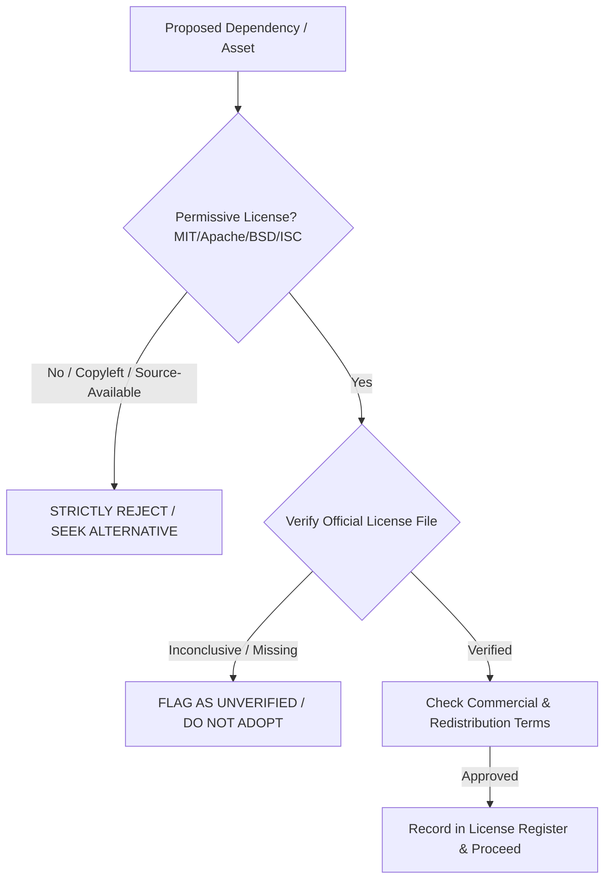

# HELIOXEN AI — Clean-Room Software Implementation Policy

**Document ID:** `HELIOXEN-POL-001`  
**Version:** `1.0.0-DRAFT`  
**Project:** HELIOXEN AI Desktop Assistant  
**Phase:** Phase 1: Product Definition and Requirements  
**Step:** 2 of 48 (Reference Analysis, Clean-Room Design and License Review)  
**Status:** Mandatory Engineering Policy (Enforced for all Subsequent Steps)  
**Date:** October 31, 2026  

---

## 1. PURPOSE AND SCOPE

This policy defines the mandatory clean-room engineering protocols, intellectual property boundaries, and provenance standards for all future development of **HELIOXEN AI**. 

Because HELIOXEN draws architectural and conceptual inspiration from existing systems (Stonic AI, Brahma Echo, Brahma AI Evo, IRIS AI, and JARVIS science-fiction concepts), strict procedural boundaries are required to guarantee that HELIOXEN is **100% original, legally clean, unencumbered by restrictive licenses, and free of copyright infringement or misappropriated code**.

This policy applies to all development phases, human contributors, and AI pair-programming agents across Steps 3 through 48.

---

## 2. ORIGINAL-CODE AUTHORING REQUIREMENTS

### 2.1 Complete Independent Development
1. **Zero Direct Code Copying:** Under no circumstances shall source code, decompiled routines, AST templates, configuration blocks, or scripts from Stonic, Brahma, IRIS, or other reference repositories be copied into HELIOXEN.
2. **Prohibition of Line-by-Line Translation:** "Paraphrasing," renaming variables, or translating restricted source files line-by-line into TypeScript is explicitly defined as creating a derivative work and is strictly prohibited.
3. **Behavioral Black-Box Derivation:** All implementation must proceed exclusively from **functional requirement specifications** (e.g., [HELIOXEN_PRODUCT_REQUIREMENTS.md](file:///d:/App%20Winrar%20Files/Helioxen%20Ai%20Assistant%20(working)/docs/HELIOXEN_PRODUCT_REQUIREMENTS.md)) and publicly documented platform APIs (e.g., standard Electron, Node.js, Web Audio, and provider SDK specifications).
4. **Independent Schema & Contract Design:** All IPC channel names, data models, database schemas, and tool parameter formats must be created with original identifiers and structures tailored specifically to HELIOXEN.

---

## 3. UI/UX ORIGINALITY AND BRAND INTEGRITY

### 3.1 Non-Infringing Visual Compositions
1. **No Pixel-for-Pixel Duplication:** HELIOXEN must never reproduce another software product's exact screen layout, component proportions, or visual themes pixel-for-pixel.
2. **Original Visual Assets:** All application icons, orbital rings, splash screens, animations, and branding elements must be original works. The user-provided [Futuristic Helioxen Orbital Logo.png](file:///d:/App%20Winrar%20Files/Helioxen%20Ai%20Assistant%20(working)/Futuristic%20Helioxen%20Orbital%20Logo.png) constitutes the sole official brand anchor.
3. **No Trademark or Character Infringement:** No copyrighted trademarks, character names, movie stills, sound bites, or logos from Marvel/Disney (e.g., JARVIS, Stark Industries, Iron Man) or commercial AI products may be used in the application interface, documentation, or marketing.

---

## 4. SOURCE-CODE AND ASSET PROVENANCE REQUIREMENTS

### 4.1 Provenance Records
Every newly introduced dependency, external icon set, audio asset, or public code snippet must have an explicit provenance entry recorded in [HELIOXEN_LICENSE_AND_ASSET_REGISTER.md](file:///d:/App%20Winrar%20Files/Helioxen%20Ai%20Assistant%20(working)/docs/HELIOXEN_LICENSE_AND_ASSET_REGISTER.md) prior to integration.

The provenance record must capture:
- Exact origin and authoritative URL.
- Copyright holder and publication date.
- Complete, unmodified SPDX license identifier.
- Applicable attribution and notice obligations.
- Intended HELIOXEN usage scope.

### 4.2 Handling of Public Snippets and Algorithms
If standard public algorithms (e.g., mathematical formulas, DSP filters, trigonometric orbital rotations) are integrated, they must:
- Originate from recognized permissive open-source repositories (MIT, Apache 2.0, BSD-2/3-Clause, Unlicense) or public educational literature.
- Include appropriate attribution comments in the source file header.

---

## 5. REFERENCE MATERIAL HANDLING AND ISOLATION

1. **Separation of Reference Documentation:** All reverse-engineering reports, PRIS summaries, and architectural audits must reside exclusively in documentation directories (e.g., `docs/`) and must never be packaged, bundled, or compiled into the distributed desktop application binary.
2. **Preservation of Third-Party Notices:** Reference summaries must retain their original metadata, authors, and disclaimers without implying that HELIOXEN owns the referenced works.
3. **Strict Isolation from Build Pipelines:** Build scripts (Vite, Electron-Builder) must explicitly exclude `docs/`, audit logs, and reference notes from the production output distribution.

---

## 6. LICENSE VERIFICATION WORKFLOW

Before any third-party npm package, library, font, or asset is added to the project, the development team must execute the following 4-step verification gate:

### 6.1 Permitted vs. Prohibited License Categories
- **Permitted (Green Tier):** MIT, Apache-2.0, BSD-2-Clause, BSD-3-Clause, ISC, CC0-1.0, Unlicense.
- **Conditional / Requires Review (Amber Tier):** MPL-2.0, LGPL-3.0 (dynamic linking only), CC-BY-4.0 (requires visual attribution review).
- **Strictly Prohibited for Core Code (Red Tier):** GPL-2.0, GPL-3.0, AGPL-3.0, SSPL, Creative Commons Non-Commercial (CC-NC), and all proprietary / source-available restricted licenses (such as Brahma Echo / Brahma AI Evo custom licenses).

---

## 7. PROHIBITED REUSE CATEGORIES

Unless verified written authorization from the copyright holder is provided, the following categories are strictly prohibited from entry into the HELIOXEN codebase:
1. **Brahma Source Code & Schemas:** Any code, AST rules, or orchestration schemas originating from Brahma Echo or Brahma AI Evo.
2. **Stonic V1/V2/V3 Implementation Files:** Any Electron main process files, IPC bridge scripts, or frontend UI components extracted from Stonic repositories.
3. **IRIS AI Application Code:** Any particle sphere shader implementations, IPC handlers, or ADB bridge scripts from IRIS AI.
4. **Cinematic Studio Trademarks & Media:** Any Marvel / Disney audiovisual assets, sound effects, or trademarked fictional terminology.

---

## 8. REVIEW CHECKPOINTS BEFORE INTEGRATION AND RELEASE

To enforce this policy throughout the 48-step lifecycle, formal clean-room checkpoints are established:

| Checkpoint Milestone | Roadmap Step | Verification Scope | Responsible Role |
| :--- | :--- | :--- | :--- |
| **Stack Selection Review** | Step 4 | Audit licenses of all proposed runtime libraries and frameworks. | Architecture Lead |
| **Repository Init Audit** | Step 5 | Scan initial repository for accidental check-ins of proprietary files. | QA & Security Reviewer |
| **IPC & Security Boundary Audit**| Step 15 | Verify zero copy-paste of insecure Stonic IPC or shell execution patterns. | Desktop Security Architect |
| **Tool System Boundary Audit** | Step 25 | Ensure all tool schemas and execution pipelines are 100% original. | System Architect |
| **Pre-Release Clean-Room Audit**| Step 47 | Automated license scan (`license-checker`) of all production dependencies. | Compliance Reviewer |

---

## 9. ESCALATION REQUIREMENTS FOR UNRESOLVED QUESTIONS

If an engineer or agent encounters an ambiguous situation (e.g., conflicting license notices in a package repository, uncertain patent grants, or similarity to a protected UI composition):
1. **Immediate Halt:** The affected task must be paused immediately.
2. **Document the Discrepancy:** The exact files, lines, and conflicting evidence must be recorded in [HELIOXEN_SOURCE_CONFLICTS_AND_OPEN_QUESTIONS.md](file:///d:/App%20Winrar%20Files/Helioxen%20Ai%20Assistant%20(working)/docs/HELIOXEN_SOURCE_CONFLICTS_AND_OPEN_QUESTIONS.md).
3. **Escalate to Product Owner:** Execution cannot resume on that component until explicit written clearance or an alternative technical approach is formally approved.

---

## 10. REVISION HISTORY

| Date | Version | Author | Description of Changes |
| :--- | :--- | :--- | :--- |
| **2026-10-31** | `1.0.0-DRAFT` | Clean-Room Reimplementation Architect | Initial formal Clean-Room Software Implementation Policy established for Step 2 of 48. Mandates 100% original code authoring, behavioral derivation, permitted/prohibited license tiers, provenance tracking, and pre-release audit checkpoints. |
