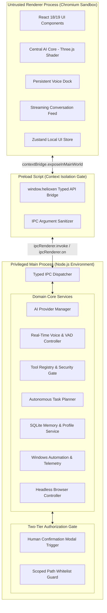
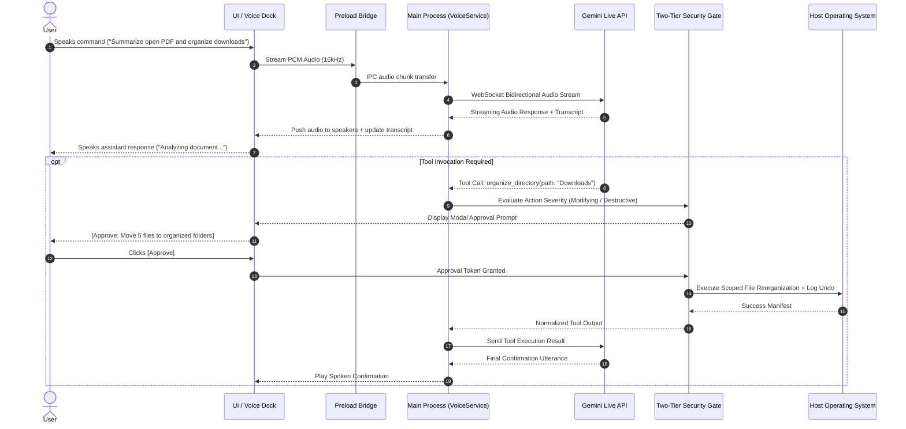
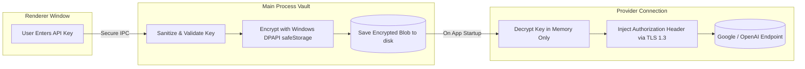
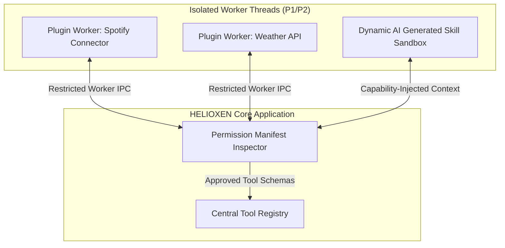

# HELIOXEN AI — System Architecture & Technical Blueprint

**Document ID:** `HELIOXEN-ARCH-001`  
**Version:** `1.0.0-DRAFT`  
**Project:** HELIOXEN AI Desktop Assistant  
**Phase:** Phase 2: Technical Architecture and Project Foundation  
**Step:** 4 of 48 (Technology Stack Selection and Architecture Decisions)  
**Status:** Approved Technical Architecture Blueprint  
**Date:** October 31, 2026  
**Target Platform:** Windows 10/11 Desktop (64-bit)  

---

## 1. ARCHITECTURAL GOALS AND SYSTEM OVERVIEW

HELIOXEN is architected as an **intelligent, local-first desktop operating layer**. Rather than wrapping a web chatbot in an unhardened Electron window, HELIOXEN establishes a multi-process, modular desktop monolith engineered for low-latency voice, reactive 3D graphics, zero-trust system automation, and strict user privacy.

### 1.1 Core Architectural Principles
1. **Zero-Trust Process Isolation:** The UI rendering layer is completely sandboxed. Privileged system access (files, OS APIs, credentials, child processes) is strictly confined to the Main process and gated by typed IPC bridges.
2. **Deterministic Tool Authorization:** The AI model is treated as an untrusted planner. Tool requests pass through schema validation, parameter whitelisting, and a mandatory two-tier modal confirmation gate before execution.
3. **Low-Latency Streaming Pipeline:** Voice, text, and telemetry streams utilize event-driven push architecture (WebSockets, IPC events) rather than polling loops.
4. **Local-First Data Sovereignty:** User memory, conversation history, notes, and preferences reside exclusively in local ACID-compliant SQLite databases.
5. **Ergonomic Simplicity + Cinematic Fidelity:** Adheres to Stonic AI's 3-panel visual clarity while rendering high-performance orbital GPU shaders inspired by the official HELIOXEN brand identity.

---

## 2. PROPOSED ARCHITECTURE DIAGRAMS

### Diagram A: System Context Diagram
```mermaid
graph TD
    User([User]) <--> |Voice / Keyboard / Mouse| UI[HELIOXEN Desktop Application]
    
    subgraph HostOS ["Host Desktop Environment (Windows 10/11)"]
        UI <--> |Encrypted DPAPI| Vault[(Windows Credential Vault)]
        UI <--> |Local SQLite WAL| DB[(Local Database & Memory)]
        UI <--> |Scoped Path Access| FS[(User Filesystem / Recycle Bin)]
        UI <--> |User32 / Shell| Apps[Installed Start Menu Applications]
        UI <--> |Sensors (Consent)| Peripherals[Microphone / Camera / Screen]
    end

    subgraph ExternalCloud ["External Cloud Services (TLS 1.3)"]
        UI <--> |Gemini Live WebSockets / REST| GeminiAPI[Google Gemini 3.8 Flash / Live]
        UI <--> |Fallback REST| OpenAIAPI[OpenAI / Anthropic APIs]
        UI <--> |Search Queries| WebSearch[Web Search API / Public Web]
    end

    subgraph OptionalFuture ["Deferred Capabilities (P2)"]
        UI -.-> |Wireless ADB| Android[Android Companion Phone]
        UI -.-> |REST / MQTT| SmartHome[Home Assistant / Hue Bridge]
    end
```

---

### Diagram B: Multi-Process Desktop Architecture


---

### Diagram C: Real-Time Voice & Tool Execution Sequence


---

### Diagram D: Data and Credential Flow


---

### Diagram E: Extension & Plugin Architecture


---

## 3. LOGICAL SUBSYSTEM RESPONSIBILITIES

### 3.1 Electron Main Process
- **Lifecycle & Windows:** Creates and manages the primary frameless `BrowserWindow`, handles system tray integration, manages power/sleep events, and coordinates clean shutdown (< 500ms).
- **Security & Authorization Gate:** Hosts the Two-Tier Permission Gate, validates IPC senders, validates Zod schemas on all tool inputs, and manages the Windows Credential Vault.
- **Hardware & Native Bindings:** Interacts with `systeminformation`, Start Menu indexers, Windows Recycle Bin APIs, and local audio capture worklets.

### 3.2 Preload Bridge & IPC Contracts
- **Strict Boundary:** Runs with `contextIsolation: true`. Exposes a single frozen, typed global object `window.helioxen`.
- **Zero Raw Emitters:** Raw `ipcRenderer.send`, `ipcRenderer.on`, or `ipcRenderer.invoke` are never exposed to the frontend. All interactions use discrete function contracts (e.g., `window.helioxen.voice.startSession()`).

### 3.3 Renderer Process (React & Three.js)
- **Visual Presentation:** Renders the 3-panel command layout, streaming markdown conversation cards, persistent voice dock, and modal approval dialogs.
- **GPU Shaders:** Renders the Three.js Central AI Core with 60fps orbital particle shaders, adapting dynamically to audio input volume and state transitions.

### 3.4 AI Provider Abstraction Layer
- **Unified Interface:** Standardizes `sendChatMessage()`, `streamVoiceSession()`, and `executeToolCall()` across multiple backends.
- **Task-Based Routing:** Routes fast audio turns to Gemini Live / Flash, deep planning to reasoning models, and local offline requests to Ollama (when enabled).

---

## 4. ERROR HANDLING, TIMEOUTS, AND CANCELLATION

1. **Global Cancellation:** Every async tool execution and network request receives an `AbortSignal`. Clicking the global [Stop Task] button triggers instant abort (< 200ms).
2. **Execution Timeouts:** All AI tool operations enforce a mandatory 30-second timeout. Tools exceeding this threshold are killed and return a timeout error to the planner.
3. **Graceful Degraded States:** When network drops, the UI does not crash or freeze; status badges transition to `OFFLINE` with actionable retry buttons.

---

## 5. PERFORMANCE AND RESOURCE BUDGETS

| Metric | Target Budget | Measurement Method | Strategy for Low-End Systems |
| :--- | :--- | :--- | :--- |
| **Cold Startup Time** | < 1.5 seconds | Performance timer from process start to interactive UI | Preload cache, lazy load secondary routes |
| **Idle RAM Footprint** | < 250 MB | Task Manager sum of Main + Renderer + GPU | Aggressive GC on closed media buffers |
| **Active Session RAM** | < 750 MB | Continuous profiling during multimodal sessions | Smart downscaling of large 4K screenshots |
| **Idle CPU Consumption**| < 0.5% | Windows performance counter over 60s minimized | Throttling Three.js render loop to 1fps when occluded |
| **Voice Turnaround** | < 800 ms | Timestamp from user speech end to initial audio packet | Direct PCM WebSockets to Google Gemini Live API |

---

## 6. REVISION HISTORY

| Date | Version | Author | Description of Changes |
| :--- | :--- | :--- | :--- |
| **2026-10-31** | `1.0.0-DRAFT` | Principal Software Architect | Comprehensive System Architecture & Technical Blueprint established for Step 4 of 48. Detailed multi-process isolation, 5 formal architecture diagrams (Mermaid), domain service boundaries, error recovery models, and performance budgets. |
