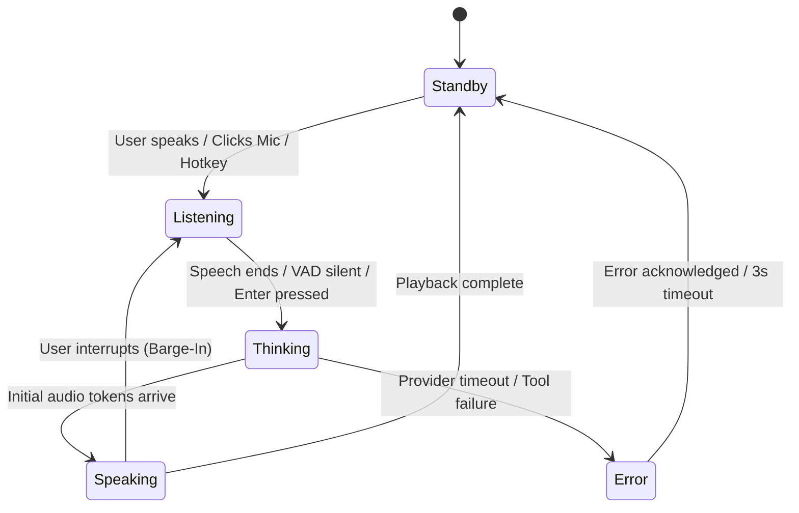

# HELIOXEN AI — UI/UX Design Hierarchy and Reference Decisions

**Document ID:** `HELIOXEN-UIUX-001`  
**Version:** `1.0.0-DRAFT`  
**Project:** HELIOXEN AI Desktop Assistant  
**Phase:** Phase 1: Product Definition and Requirements  
**Step:** 2 of 48 (Reference Analysis, Clean-Room Design and License Review)  
**Status:** Approved UI/UX Design Direction  
**Date:** October 31, 2026  

---

## 1. PURPOSE AND DESIGN MANDATE

This document formalizes the user interface and user experience (UI/UX) design direction for **HELIOXEN AI**. 

It details how the user's explicit design mandate:
> **"Stonic-inspired simplicity + cinematic JARVIS-inspired atmosphere + an original HELIOXEN identity"**

will be synthesized into an original, ergonomic, high-performance desktop interface. 

This specification establishes the architectural layouts, interaction patterns, visual design tokens, and progressive disclosure rules that will guide subsequent UI engineering (Phase 2, Steps 7 through 12). **No runtime code or UI styles are implemented during this step.**

---

## 2. REFERENCE HIERARCHY AND DESIGN SYNTHESIS

```
+---------------------------------------------------------------------------------------+
|                                  HELIOXEN UI/UX SYNTHESIS                             |
+---------------------------------------------------------------------------------------+
|  [ PRIMARY INSPIRATION ]       [ ATMOSPHERIC INSPIRATION ]     [ FUNCTIONAL CONCEPTS ] |
|  Stonic AI                     JARVIS HUD Benchmark            IRIS AI & Brahma        |
|  - 3-Panel Clean Layout        - Luminous Orbital Rings        - Reactive 3D Sphere    |
|  - Central AI Core Focus       - Cinematic Hologram Glow       - Screen/Camera Modals  |
|  - Restrained Sidebars         - Crisp High-Tech Typography    - Execution Trace Cards |
|  - Instant Voice Dock          - Subtle Telemetry Badges       - Dynamic Skills UI     |
+---------------------------------------------------------------------------------------+
                                           |
                                           v
+---------------------------------------------------------------------------------------+
|                           ORIGINAL HELIOXEN BRAND IDENTITY                            |
|  - Anchored by Futuristic Helioxen Orbital Logo (Neon Cyan #00f0ff + Deep Blue)       |
|  - Uncluttered Ergonomics: zero visual noise, no confusing multi-gauge dashboards      |
|  - High Performance: 60fps canvas/shaders with instant reduced-motion accessibility   |
+---------------------------------------------------------------------------------------+
```

### 2.1 Why Stonic AI is the Primary Reference
Brahma Echo and Brahma AI Evo provided valuable backend architecture, but their interfaces suffer from **dashboard congestion**: dense grids of simultaneous gauges, graphs, process trees, and device monitors that overwhelm the user. 

Stonic AI, by contrast, prioritizes **calm visual focus**:
- The user's attention is drawn directly to the **Central AI Core**.
- Navigation is confined to a clean, vertical left dock.
- Dialogue and tool outputs stream into a dedicated, readable context panel.
- Advanced features (Memory, Skills, Character tuning) reside in dedicated views rather than crowding the home screen.

HELIOXEN adopts Stonic's clean architectural discipline while elevating its visual fidelity with cinematic orbital graphics inspired by the HELIOXEN brand.

---

## 3. PROPOSED HOME-SCREEN ARCHITECTURE & HIERARCHY

The HELIOXEN home screen utilizes a responsive three-panel command layout designed for high-resolution desktop displays (1080p, 1440p, 4K) while remaining functional down to 1024x640:

```
+---------------------------------------------------------------------------------------+
| (H) HELIOXEN AI      |  STATUS: NOMINAL  |  MODEL: GEMINI 3.8 FLASH  |  _   [ ]   X   |  <- Titlebar
+----------------------+-----------------------------------------------+----------------+
|                      |                                               |                |
|  [ CORE ]            |               . - ~ ~ ~ - .                   |  CONVERSATION  |
|  [ MEMORY ]          |           . '   /  \    /  \ ' .              |                |
|  [ SKILLS ]          |          /    (   (  H  )   )    \            |  User: Check   |
|  [ CHARACTER ]       |         |      \   /    \   /     |           |  system status |
|  [ TOOLS ]           |          \       ` - ~ - '       /            |  and schedule  |
|  [ MONITOR ]         |           ' .                 . '             |                |
|  [ SETTINGS ]        |               ` - ~ ~ ~ - '                   |  AI: Systems   |
|                      |             STATUS: LISTENING...              |  nominal. 3    |
|                      |                                               |  tasks today.  |
|                      |   +---------------------------------------+   |                |
|                      |   |  > Ask anything or run a command...  |   |  [Trace: 18ms] |
|                      |   +---------------------------------------+   |                |
|                      |                                               |                |
|                      |   [ (o) LIVE MIC | GAIN: 80% | DISCONNECT ]   |                |
+----------------------+-----------------------------------------------+----------------+
|  CPU: 8%  |  RAM: 28%  |  NET: 12ms  |  VAULT: SECURE  |  BUILD: 1.0.0-DRAFT          |  <- Status Bar
+---------------------------------------------------------------------------------------+
```

### 3.1 Primary Structural Zones
1. **Custom Branded Titlebar (Top):** Hosts the glowing miniature HELIOXEN orbital emblem, application wordmark, connection health pill, model badge, and native Windows window control buttons.
2. **Left Navigation Rail (Width: ~72px collapsed / ~200px expanded):** Houses icon buttons for Core, Memory, Skills, Character, Tools, Monitor, and Settings. Includes smooth tooltips and active glow indicators.
3. **Center Primary Intelligence Workspace:** Dominated by the dynamic **Central AI Core**, with the interactive command input bar anchored directly below, accompanied by the persistent voice dock.
4. **Right Context Panel (Width: ~340px to ~420px, collapsible):** Houses the threaded conversation transcript, rich Markdown blocks, copyable code snippets, and expandable tool execution trace cards.
5. **System Telemetry Footer (Bottom, Height: ~28px):** Subtle, non-intrusive status readout displaying live CPU/RAM utilization, network latency, credential vault status, and build metadata.

---

## 4. CENTRAL AI CORE BEHAVIOR & INTERACTION STATES

The Central AI Core is the visual and emotional centerpiece of HELIOXEN. It visually derives from the [Futuristic Helioxen Orbital Logo.png](file:///d:/App%20Winrar%20Files/Helioxen%20Ai%20Assistant%20(working)/Futuristic%20Helioxen%20Orbital%20Logo.png) (neon cyan rings encircling a deep blue orb).

### 4.1 State Machine Visual Behaviors



| Operational State | Primary Visual Appearance | Orbital Ring Dynamic | Luminous Color Scheme |
| :--- | :--- | :--- | :--- |
| **Standby / Idle** | Gentle breathing pulse (0.5 Hz) | Slow, steady horizontal orbit | Deep Orbital Blue (`#0055ff`) with subtle cyan fringe |
| **Listening** | Reactive audio visualizer | Outer rings expand and pulse with microphone volume | Vivid Neon Cyan (`#00f0ff`) with bright white core |
| **Thinking / Analyzing**| Inner core compresses and glows | Rings accelerate into dual-axis gyroscopic spin | Electric Cyan & Violet particle trails radiating inward |
| **Speaking** | Harmonics match assistant speech | Rings stabilize into resonant undulating orbital waves | Brilliant Sky Cyan (`#38bdf8`) pulsing with audio output |
| **Awaiting Approval** | Pulsing warning beacon | Rings pause at 45-degree angle pointing to approval modal | Warm Amber (`#f59e0b`) with soft yellow perimeter |
| **Error / Offline** | Low-energy dim state | Rings contract tightly around orb; single crimson pulse | Amber / Crimson Warning (`#ef4444`) with descriptive badge |

---

## 5. CONVERSATION AND VOICE DOCK ERGONOMICS

### 5.1 Persistent Voice Dock
The voice dock is an always-accessible control widget rendered directly beneath the command bar:
- **Live State Indicator:** Glowing green/cyan dot indicates an active microphone session.
- **Audio Meter:** Dynamic 5-bar VU meter or micro-waveform reflecting real-time input gain.
- **Mute / Unmute Toggle:** Instant one-click toggle with visual red slash when muted.
- **Global Hotkey:** `Ctrl+M` or user-configured shortcut toggles voice from anywhere in the OS.

### 5.2 Visible Execution Trace (No Private Chain-of-Thought Leaks)
When the assistant executes desktop tools (file search, web retrieval, app launch), the right context panel renders a **Sanitized Execution Card**:
- **Header:** Tool name (e.g., `BrowserSearch`, `FileIndex`) with spinning micro-loader.
- **Payload:** Clean, formatted summary of search query or target directory (sensitive tokens masked).
- **Execution Output:** Formatted result preview with status badge (`SUCCESS` in green, `FAILED` in red).
- **Security Rule:** Raw internal model reasoning or unfiltered chain-of-thought tokens are stripped to maintain a polished, professional user experience.

---

## 6. PROGRESSIVE DISCLOSURE OF ADVANCED MODULES

To keep the home screen uncluttered, secondary workflows are accessed through dedicated views:

| Module | Navigation Entry | Workspace Replacement | Return Behavior |
| :--- | :--- | :--- | :--- |
| **Memory Bank** | Left Nav `[MEMORY]` | Replaces center core with searchable memory records, topic filters, and delete buttons. | Instant click on `[CORE]` returns to orbital view; active voice session maintained. |
| **Skills Manager** | Left Nav `[SKILLS]` | Displays installed plugins, permission manifests, and toggle switches. | Instant return; uninstalled tools immediately disappear from model schema. |
| **Character Tuning** | Left Nav `[CHARACTER]`| Personality archetypes (JARVIS, Minimalist, Cyberpunk) with custom prompt editor. | Instant return; new personality takes effect on next turn. |
| **World Monitor** | Left Nav `[MONITOR]` | Expands into interactive 3D HoloGlobe with news feeds and weather. | Dedicated view; 3D rendering pauses when switching away to preserve GPU. |
| **Settings** | Left Nav `[SETTINGS]`| Provider API keys, model routes, audio device pickers, and theme toggles. | Saves immediately; encrypted keys stored in OS Keychain. |

---

## 7. PROPOSED VISUAL DESIGN TOKENS

```css
/* Proposed Helioxen Design Tokens (Preliminary Baseline for Step 7) */
:root {
  /* Surfaces */
  --hx-bg-space: #070a10;           /* Deepest background */
  --hx-bg-panel: #0d121d;           /* Panel surface */
  --hx-bg-card: #131b2a;            /* Card / modal surface */
  --hx-bg-hover: #1c273c;           /* Hover highlight */

  /* Borders & Dividers */
  --hx-border-subtle: rgba(56, 189, 248, 0.12);
  --hx-border-glow: rgba(0, 240, 255, 0.35);

  /* Brand Accents (Derived from Futuristic Helioxen Orbital Logo) */
  --hx-neon-cyan: #00f0ff;          /* Primary vibrant accent */
  --hx-sky-cyan: #38bdf8;           /* Secondary active accent */
  --hx-orbital-blue: #0055ff;       /* Core energy blue */
  --hx-deep-blue: #0b1e3f;          /* Core shadow blue */

  /* Status Colors */
  --hx-status-nominal: #10b981;     /* Emerald green */
  --hx-status-warning: #f59e0b;     /* Amber */
  --hx-status-danger: #ef4444;      /* Crimson red */
  --hx-status-info: #00f0ff;        /* Neon cyan */

  /* Typography */
  --hx-font-display: 'Outfit', sans-serif;
  --hx-font-body: 'Inter', -apple-system, sans-serif;
  --hx-font-mono: 'JetBrains Mono', monospace;
}
```

---

## 8. ACCESSIBILITY, REDUCED MOTION, AND PATTERNS TO AVOID

### 8.1 Accessibility & Reduced Motion
- **WCAG AA Compliance:** All body text must maintain contrast ratios > 4.5:1 against dark backgrounds.
- **Reduced Motion Support:** Respects system `prefers-reduced-motion: reduce`. When active:
  - 3D orbital particle effects are replaced with a clean, static vector emblem.
  - State changes transition via gentle opacity fades rather than rapid rotational acceleration.
- **Full Keyboard Navigation:** Command input supports `Ctrl+K` invocation; `Tab` key cycles smoothly through all interactive buttons with high-visibility cyan focus rings.

### 8.2 Visual Patterns Explicitly Avoided
1. **The "Brahma Multi-Gauge Trap":** Do not clutter the primary interface with 15 simultaneous performance dials and memory graphs.
2. **Unreadable Movie HUDs:** Do not use angled, low-contrast, microscopic sci-fi text that strains the eyes.
3. **Garish Rainbow Gradients:** Keep the color palette disciplined: deep space darks with refined cyan and orbital blue luminous highlights.

---

## 9. REVISION HISTORY

| Date | Version | Author | Description of Changes |
| :--- | :--- | :--- | :--- |
| **2026-10-31** | `1.0.0-DRAFT` | Lead Desktop UI/UX Architect | Initial UI/UX Reference Decisions specification for Step 2 of 48. Established Stonic-inspired 3-panel architecture, orbital AI core state machine, progressive disclosure model, preliminary design tokens, and accessibility standards. |
