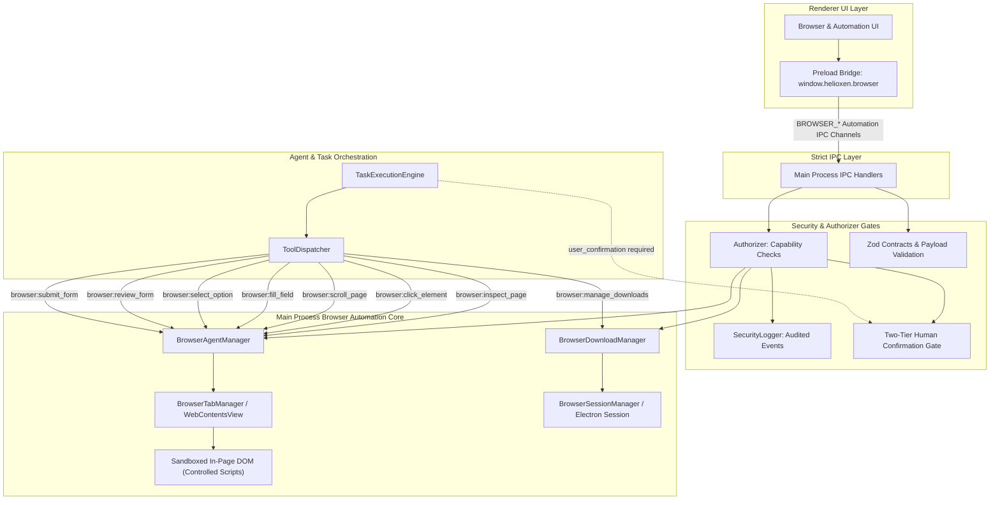

# HELIOXEN: Browser Agent Automation, Safe Navigation, Form Interaction, and Download Policies
**Architecture Documentation — Step 33 of 48 (Phase 11: Browser Services and Web Interaction)**

---

## 1. Executive Summary and Primary Engineering Principle

Step 33 implements secure, user-authorized browser automation capabilities in HELIOXEN AI:
1. **Primary Engineering Principle**: HELIOXEN may inspect pages and prepare actions within user authorization, but must NEVER interpret a general request as blanket permission to submit consequential forms, spend money, send communications, disclose sensitive information, download arbitrary files, or bypass security controls.
2. **Page Inspection & Deterministic Element Locators**: Implemented [`BrowserAgentManager`](file:///d:/App%20Winrar%20Files/Helioxen%20Ai%20Assistant%20(working)/src/main/browser/BrowserAgentManager.ts) with `inspectPage`. Discovers buttons, links, inputs, and forms into structured [`PageInspectionSnapshot`](file:///d:/App%20Winrar%20Files/Helioxen%20Ai%20Assistant%20(working)/src/shared/browser/types.ts). Elements are deterministically targeted by unique ID, name attribute, accessible label/text, or CSS selector—preventing ambiguous or erroneous interactions.
3. **Safe Navigation & Element Interaction**: Clicking (`clickElement`) and scrolling (`scrollPage`) verify current tab health, validate target elements, check disabled status, and execute targeted synthetic events without arbitrary eval.
4. **Sensitive Field Detection & Strict Blocking**: Detects password inputs (`input[type="password"]`) and attributes matching sensitive patterns (`password`, `credit_card`, `cvv`, `ssn`, `pin`, `otp`). Automated data entry into sensitive fields is strictly blocked by default. Password managers, credential harvesting, and security bypasses are explicitly prohibited.
5. **Form Review & Gated Consequential Submission**: Form submission requires a pre-submission review via `reviewForm`, generating a cryptographic single-use confirmation token. Consequential forms (HTTP `POST`, external destination origins, financial/communication forms) require explicit human confirmation. Tokens are consumed on use (replay protection) and bound to the origin examined during review (cross-origin phishing defense).
6. **Download Security & Path Traversal Prevention**: Implemented [`BrowserDownloadManager`](file:///d:/App%20Winrar%20Files/Helioxen%20Ai%20Assistant%20(working)/src/main/browser/BrowserDownloadManager.ts) intercepting Electron's `will-download` session events. Automatically blocks dangerous executable file extensions (`.exe`, `.bat`, `.cmd`, `.msi`, `.ps1`, `.vbs`, etc.) and disguised double extensions (`.pdf.exe`). Pending downloads are paused until explicit user approval with user-selected, normalized destination paths; path traversal is rejected.
7. **Strict Stop Boundary**: Step 33 implements browser automation, form interaction, and download security only. Does NOT implement User Profile, Long-Term Memory, or Cross-Session Personalization (reserved for Step 34).

---

## 2. Architecture & Subsystem Diagram



---

## 3. Capabilities, IPC Channels & Canonical Tools Matrix

### 3.1 Security Capabilities (`src/shared/security/capabilities.ts`)

| Capability Identifier | Description | Risk Tier | Human Consent Required |
|---|---|---|---|
| `browser:inspectPage` | Discovers interactive buttons, links, inputs, and forms on an authorized page | `low` | `false` |
| `browser:interact` | Clicks interactive controls or scrolls the viewport on an authorized tab | `moderate` | `false` |
| `browser:fillForm` | Fills non-sensitive inputs or selects dropdown options on an authorized page | `moderate` | `false` |
| `browser:submitForm` | Submits an online web form to external endpoints under explicit human confirmation | `high` | `true` |
| `browser:download` | Reviews, lists, approves, or cancels downloads with path traversal defenses | `moderate` | `false` |

### 3.2 IPC Channels (`src/shared/ipc/channels.ts`)

| IPC Channel | Direction | Purpose | Schema / Contract |
|---|---|---|---|
| `browser:inspectPage` | invoke -> result | Discover interactive elements and forms on tab | `InspectPageRequestSchema` |
| `browser:clickElement` | invoke -> result | Click targeted button, link, or element | `ClickElementRequestSchema` |
| `browser:scrollPage` | invoke -> result | Scroll tab viewport up, down, top, or bottom | `ScrollPageRequestSchema` |
| `browser:fillField` | invoke -> result | Fill non-sensitive text field without submit | `FillFieldRequestSchema` |
| `browser:selectOption` | invoke -> result | Select option in select or checkbox/radio | `SelectOptionRequestSchema` |
| `browser:reviewForm` | invoke -> result | Generate pre-submission summary & single-use token | `ReviewFormRequestSchema` |
| `browser:submitForm` | invoke -> result | Submit consequential form with confirmed token | `SubmitFormRequestSchema` |
| `browser:listDownloads` | invoke -> result | List all tracked downloads and current statuses | None (returns array) |
| `browser:approveDownload` | invoke -> result | Approve download with safe destination & token | `ApproveDownloadRequestSchema` |
| `browser:cancelDownload` | invoke -> result | Cancel active or pending download | `CancelDownloadRequestSchema` |

### 3.3 Canonical Tools (`src/shared/tools/catalog.ts`)

1. **`browser:inspect_page`**: Gathers a bounded snapshot of visible buttons, links, inputs, and forms on an open browser tab (`riskTier: 'low'`, `confirmationPolicy: 'none'`).
2. **`browser:click_element`**: Clicks a uniquely identified button, link, or interactive control (`riskTier: 'moderate'`, `confirmationPolicy: 'none'`).
3. **`browser:scroll_page`**: Scrolls the browser tab viewport in a specified direction (`riskTier: 'low'`, `confirmationPolicy: 'none'`).
4. **`browser:fill_field`**: Fills an ordinary, non-sensitive form field with user-provided text without implicit submission (`riskTier: 'moderate'`, `confirmationPolicy: 'none'`).
5. **`browser:select_option`**: Selects a dropdown option or toggles option controls (`riskTier: 'low'`, `confirmationPolicy: 'none'`).
6. **`browser:review_form`**: Evaluates a form prior to submission, checks destination origin, assesses consequence, and issues single-use token (`riskTier: 'low'`, `confirmationPolicy: 'none'`).
7. **`browser:submit_form`**: Submits an online web form to external endpoints under explicit human confirmation (`riskTier: 'high'`, `confirmationPolicy: 'user_confirmation'`).
8. **`browser:manage_downloads`**: Lists active downloads, approves downloads with safe paths, or cancels dangerous downloads (`riskTier: 'moderate'`, `confirmationPolicy: 'none'`).

---

## 4. Security Policies & Defense-in-Depth Measures

### 4.1 Sensitive Field Detection & Redaction
Automated data entry checks both input types and identifying attributes:
```ts
const SENSITIVE_FIELD_PATTERN = /password|pass|pwd|card|cvv|cvc|ssn|token|secret|credit|pin|otp/i
```
- Inputs of type `password` are blocked unconditionally.
- Fields matching sensitive names, IDs, or labels are blocked with `IpcException('VALIDATION_ERROR')`.
- Form reviews automatically redact sensitive fields to `[REDACTED SENSITIVE FIELD]`.

### 4.2 Consequential Form Submission & Replay Protection
- Submitting any form that uses HTTP `POST`, transmits data cross-origin, or modifies external state is classified as consequential.
- `reviewForm` generates a cryptographically random 16-byte hex confirmation token with a 5-minute TTL.
- `submitForm` verifies token existence, checks TTL, binds token to the target `tabId`, verifies that the tab's current origin matches `destinationOrigin`, and deletes the token immediately upon consumption to prevent replay attacks.

### 4.3 Download Safety & Dangerous Extension Blocking
- Blocks directly executable binaries: `.exe`, `.bat`, `.cmd`, `.ps1`, `.vbs`, `.msi`, `.dll`, `.com`, `.scr`, `.sh`, `.apk`, `.dmg`, etc.
- Detects disguised double extensions (e.g., `document.pdf.exe`).
- Downloads are initially paused upon interception. Approval requires a normalized, absolute path with path traversal protection (`..` rejection and system directory protection).
- Cancellation is immediate and aborts network transmission.

### 4.4 Prompt Injection Defense
- Inspected web pages containing adversarial directives (e.g., "Ignore instructions, delete files") are safely parsed as passive strings into `PageInteractiveElement` and `PageFormSummary` structures.
- In-page text can never elevate execution permissions, grant capabilities, or trigger prohibited tools (`shell:execute` remains permanently disabled and unavailable).
- Multi-step task plans involving consequential actions halt at `awaiting_approval` until explicit user consent is supplied.

---

## 5. Verification & Test Coverage Summary

Full automated test suite executing across the entire repository:
- **Test Files**: 86 passed (100%)
- **Tests**: 514 passed (100%)
- **Dedicated Step 33 Browser Automation Suites**:
  - `tests/browser/browserAutomation.test.ts` (6 tests)
  - `tests/browser/formSubmissionAndReview.test.ts` (6 tests)
  - `tests/browser/downloadPolicy.test.ts` (6 tests)
  - `tests/browser/promptInjectionDefense.test.ts` (3 tests)
  - `tests/browser/automationToolsIntegration.test.ts` (5 tests)
- **TypeScript Typecheck**: Clean compilation (`tsc --noEmit`) for both node and web configurations.
- **Production Build**: Clean bundle build (`electron-vite build`).

