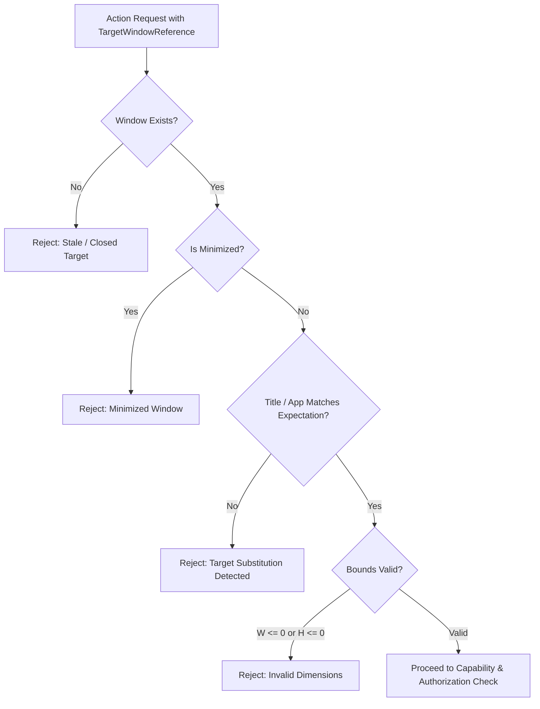

# HELIOXEN: Keyboard, Mouse and System Commands with Confirmations and Undo
**Architecture Documentation — Step 30 of 48 (Phase 10: Desktop Awareness and System Interaction)**

---

## 1. Executive Summary and Architectural Principles

Step 30 implements a secure, permission-controlled desktop interaction subsystem for HELIOXEN AI:
1. **No Direct Model Control**: AI-generated instructions are strictly treated as proposals. Execution requires target validation, capability authorization, and user confirmation before any consequential action.
2. **Controlled Keyboard Interaction**: Executes named, allowlisted keyboard shortcuts (`Copy`, `Paste`, `Cut`, `SelectAll`, `Undo`, `Redo`, `Escape`, `Enter`, `Tab`, `Backspace`, `Delete`, `Arrow*`, `Home`, `End`, `Page*`) and bounded text entry (default 500 chars, max 2000 chars) into verified targets. Guarantees key-down/key-up lifecycle paired delivery and modifier cleanup in `finally` blocks.
3. **Controlled Mouse Interaction**: Dispatches bounded, target-relative clicks and scrolling. Strictly validates coordinates within target window boundaries $[0, \text{width}) \times [0, \text{height})$. Rejects negative or out-of-bounds coordinates and clamps scroll deltas to $[-1000, 1000]$.
4. **Predefined System Operations Allowlist**: Exposes only safe, typed system operations (`open_path`, `show_in_folder`, `open_external_url`, `alert_beep`, `get_display_metrics`). Strictly blocks arbitrary shell, PowerShell, cmd, or script execution.
5. **Target Verification & Stale Detection**: `TargetResolver` verifies window existence, title substring, application association, and non-zero dimensions via Step 28 window discovery. Rejects stale, closed, or minimized targets.
6. **Consequence-Aware Confirmation**: Integrates with Step 14/25 `ConsentGate`. High-risk operations (`desktop:sendText`, `system:openExternalUrl`) strictly require one-time human confirmation tokens.
7. **Emergency Stop & Verified Undo**: Immediate emergency stop (`emergencyStop`) halts active sequences and releases held modifiers. Verified undo is maintained for reversible actions (`text_entry`, `keyboard_action`), while non-reversible actions (`click`, `open_url`) explicitly declare `undoable: false`.

---

## 2. Supported Action Catalog & Contract Matrix

| Tool Identifier | Action Type | Target Requirement | Risk Tier | Confirmation Policy | Cancellation Support | Undo / Recovery Guarantee |
|---|---|---|---|---|---|---|
| `desktop:focus_window` | Focus Window | Verified Window ID | Low | `none` | Immediate | Reversible (refocus prior window) |
| `desktop:send_key_action` | Shortcut | Verified Window ID | Moderate | `none` | Keyup release | Reversible (`Ctrl+Z` undo tracking) |
| `desktop:send_text` | Text Entry | Focused Target Window | High | `user_confirmation` | Immediate stop | Reversible (stored token undo) |
| `desktop:send_click` | Mouse Click | Bounds $[0, W) \times [0, H)$ | Moderate | `none` | Button release | Not Reversible (`undoable: false`) |
| `desktop:send_scroll` | Scroll | Valid Target Window | Moderate | `none` | Immediate | Not Reversible (`undoable: false`) |
| `desktop:emergency_stop` | Safety Control | System-wide | Low | `none` | Non-blocking | Irreversible safety state |
| `desktop:undo_last_action` | Recovery | Undo Token / Target | Low | `none` | Non-blocking | Inverse operation execution |
| `system:open_path` | System Open | Validated Disk Path | Moderate | `none` | OS Non-interruptible | Not Reversible |
| `system:show_in_folder` | Explorer Reveal | Validated Disk Path | Low | `none` | Non-blocking | Non-destructive view state |
| `system:open_external_url` | Browser Open | `https:` or `http:` URL | High | `user_confirmation` | OS Non-interruptible | External browser side effect |
| `system:alert_beep` | System Alert | None | Low | `none` | Transient sound | Not Reversible |
| `system:get_display_metrics`| Query Display | None | Low | `none` | Non-blocking | Read-only |

---

## 3. Window Target Resolution and Pre-Dispatch Validation

### 3.1 Verification Flow


### 3.2 Target Resolver Guarantees
- Validates that target window references exist at execution time.
- Verifies application association to prevent targeting an unintended window substituted under a similar title.
- Rejects minimized windows to prevent delivering invisible input.
- Binds confirmation tokens strictly to the verified target reference.

---

## 4. Controlled Keyboard and Mouse Lifecycles

### 4.1 Paired Key Lifecycle & Modifier Safety
For native input injection, every key press must be safely released even if errors occur during dispatch:
```typescript
try {
  modifiers.forEach((m) => this.activeModifierStates.add(m))
  this.adapter.sendInputEvent(win, { type: 'keyDown', keyCode, modifiers })
  this.adapter.sendInputEvent(win, { type: 'keyUp', keyCode, modifiers })
} finally {
  this.releaseModifiers(win)
}
```

### 4.2 Text Entry Constraints
- Text is inserted as pure data via Electron's `webContents.insertText()`.
- Maximum length is strictly bounded (default 500 characters, hard ceiling 2000 characters).
- Never appends implicit `Enter`, `Tab`, or carriage returns. Typing text and submitting text remain strictly decoupled actions.

### 4.3 Mouse Coordinate Validation
- All mouse click coordinates $(x, y)$ are validated relative to the target window client rect.
- Rejects negative coordinates and coordinates $\ge$ window dimensions.
- Scroll deltas are clamped to $[-1000, 1000]$ pixels.

---

## 5. Predefined System Operations Allowlist

Arbitrary shell execution is completely prohibited. Only 5 specific, type-safe operations are permitted:
1. `system:open_path`: Resolves canonical path; checks existence; rejects Windows protected directories (`C:\Windows`, `C:\Program Files`, `System32`) and reserved device names (`CON`, `PRN`, `AUX`, `NUL`, `COM1-9`, `LPT1-9`).
2. `system:show_in_folder`: Reveals file or folder in Windows File Explorer without executing it.
3. `system:open_external_url`: Validates `https:` or `http:` schemes; rejects `file:`, `javascript:`, `powershell:`, and `data:` schemes; opens in system default web browser.
4. `system:alert_beep`: Triggers standard system alert notification sound.
5. `system:get_display_metrics`: Returns safe primary and secondary screen dimensions and DPI scaling factors.

---

## 6. Emergency Stop, Cancellation, and Verified Undo

### 6.1 Emergency Stop
- Accessible via `desktop:emergency_stop` tool, IPC channel `desktop:emergencyStop`, and renderer API `window.helioxen.desktop.emergencyStop()`.
- Halts active automation sequences, releases all held modifiers across all windows, and blocks subsequent interaction until explicitly reset.

### 6.2 Verified Undo Engine
- Reversible actions (`text_entry`, `keyboard_action`) register an `InteractionUndoRecord` in memory with an `undoToken`.
- When undo is requested:
  1. Locates undo record by token or latest active entry.
  2. Re-validates that the target window is still alive and accessible.
  3. Dispatches inverse key events (`Ctrl+Z` undo shortcut).
  4. Marks undo record as reverted (`undoneAt`).
  5. Prevents double-undoing.
- External actions (clicks, open URL) are marked non-reversible and will never present a fake undo outcome.

---

## 7. Security and Process Boundaries

- **Main Process Isolation**: All OS and Electron input APIs (`sendInputEvent`, `insertText`, `shell`, `screen`) execute exclusively within the trusted Node.js main process.
- **Strict Preload Bridge**: `window.helioxen.desktop` provides typed, payload-validated IPC wrappers. The renderer has zero direct access to native handles or input injection.
- **Data Minimization in Audit Logs**: Keystrokes, full typed text, passwords, and sensitive window titles are excluded or redacted from execution audit trails.
- **Zero Background Surveillance**: No background keyboard hooks, mouse tracking, or keylogging utilities are installed.

---

## 8. Verification and Test Coverage

**Test Results**: 69 test files, 416 tests passing (100% green).
- `tests/interaction/actionCatalog.test.ts` (5 tests)
- `tests/interaction/targetResolver.test.ts` (7 tests)
- `tests/interaction/keyboardInteraction.test.ts` (5 tests)
- `tests/interaction/mouseInteraction.test.ts` (4 tests)
- `tests/interaction/systemOperations.test.ts` (8 tests)
- `tests/interaction/emergencyStopAndUndo.test.ts` (3 tests)
- `tests/interaction/interactionToolsIntegration.test.ts` (5 tests)

TypeScript typechecking passed with 0 errors across both `node` and `web` targets. Production build completed cleanly with 0 errors.

