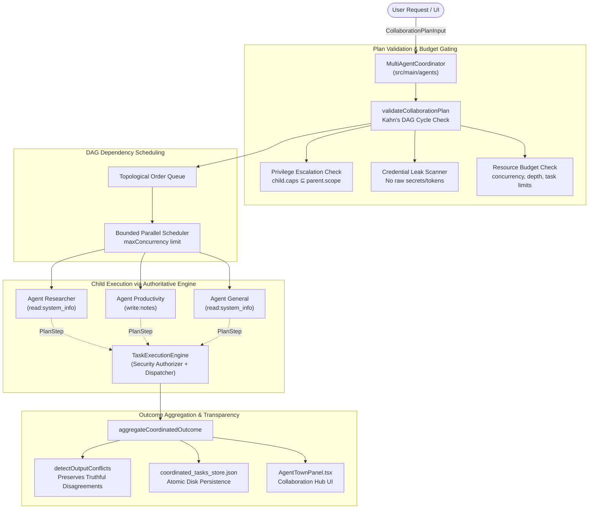

# HELIOXEN AI — Multi-Agent Collaboration, Delegation, and Coordinated Task Execution

**Project:** HELIOXEN AI  
**Roadmap Phase:** Phase 14, Agent Orchestration and Extensibility  
**Step Number:** Step 41 of 48  
**Architecture Status:** Production Verified  

---

## 1. Executive Summary & Design Vision

Step 41 elevates HELIOXEN from isolated agents and static plugins into a **bounded, reliable, and truthful multi-agent collaboration system**. While Step 40 established the foundational Agent Town experience, agent catalogs, plugin connector descriptors, and declarative skills, Step 41 coordinates multiple registered agents (`agent_general`, `agent_researcher`, `agent_coding`, `agent_productivity`, `agent_system_operator`) to solve complex user objectives through structured delegation envelopes, DAG dependency validation, resource budgeting, and truthful consensus aggregation.

### Invariant Non-Negotiables:
1. **Single Execution Authority:** The `MultiAgentCoordinator` never executes tools directly, bypasses permission gates, or instantiates competing execution engines. All tool side-effects are translated to `PlanStep` / `TaskPlan` structures and dispatched through the authoritative `TaskExecutionEngine`.
2. **Strict Privilege Inheritance:** A delegated child task can never exceed the authorized capability scope of its parent task (`child.requiredCapabilities ⊆ parent.authorizedScope`). Any child attempting privilege escalation is rejected during plan validation before dispatch.
3. **Context Isolation:** Context envelopes forwarded to children contain only the minimum verified inputs, predecessor outputs, and source provenance required for their subtask. Raw credentials, authorization tokens, passwords, and unrelated profile records are strictly scrubbed and blocked.
4. **Kahn's DAG Dependency Scheduling:** Inter-task dependencies are modeled as a Directed Acyclic Graph (DAG) and verified using Kahn's topological sort. Circular dependencies are rejected immediately.
5. **Truthful Consensus & Disagreement Preservation:** If specialized agents reach contradictory findings, the system never fabricates artificial agreement. Disagreements are preserved and highlighted in `conflicts` and `limitations` blocks for human review.
6. **Cooperative Cancellation & Failure Cascading:** If a prerequisite child task fails or is cancelled, dependent downstream tasks are marked `blocked` without wasting system resources. Cancelling a parent task cooperatively cancels all pending, ready, and running children, resetting agent runtime statuses back to `idle`.

---

## 2. Multi-Agent Collaboration Architecture

---

## 3. Data Structures & Protocol Contracts

### 3.1. Collaboration Contracts (`src/shared/agents/collaborationTypes.ts`)
- **`CoordinatedParentTask`**: The authoritative top-level record tracking the multi-agent workflow, user intent, authorized scope, budget limits, child tasks mapping, aggregate progress, and final outcome.
- **`ChildTaskRecord`**: Individual record tracking a child task's status (`ready`, `pending`, `running`, `completed`, `blocked`, `failed`, `cancelled`), assigned agent, delegation depth, dependencies, input envelope, output, error, and duration.
- **`DelegatedContextEnvelope`**: The bounded context packet containing:
  - `objective`: Specific subtask goal.
  - `inputData`: Subtask-specific parameters.
  - `predecessorOutputs`: Verified results from satisfied upstream dependencies.
  - `capabilityConstraints`: Explicit array of permitted capabilities.
  - `sourceProvenance`: Optional citation references.
  - `isReadOnly`: Read-only safety flag.
- **`CollaborationResourceBudget`**:
  - `maxChildTasks`: Maximum permitted child tasks (default: 10).
  - `maxDelegationDepth`: Maximum recursion tree depth (default: 3).
  - `maxConcurrency`: Maximum parallel tasks executing simultaneously (default: 4).
  - `maxExecutionTimeMs`: Total execution time budget (default: 60,000ms).
  - `maxRetriesPerChild`: Maximum retry attempts per child task (default: 1).
- **`ConflictingClaim`**: Structured record of opposing findings across agents, capturing `fieldOrTopic`, `agentA`, `agentB`, and `resolutionStrategy` (`preserved_both` | `user_escalation_required` | `latest_evidence`).

---

## 4. Security & Isolation Boundaries

1. **Two-Tier Privilege Containment:**
   Every child task's `requiredCapabilities` is checked against `parentTask.authorizedScope`. If a child requires a capability outside the parent scope, the collaboration plan is rejected before dispatch.
2. **Context Envelope Credential Scrubbing:**
   The `inputEnvelope.inputData` is inspected for credential leaks (`bearer`, `api_key`, `apikey`, `password`, `secret`, `client_secret`). Any occurrence triggers a `Security boundary violation` rejection.
3. **Cooperative Cancellation Protocol:**
   `MultiAgentCoordinator` maintains an `AbortController` per parent task. If the parent workflow is cancelled by the user or an IPC event, the abort signal propagates immediately to all active tools and child tasks.
4. **Agent Registry Status Truthfulness:**
   Agents are set to `status: 'running'` during execution and automatically reverted to `status: 'idle'` upon completion, failure, or cancellation.

---

## 5. UI Implementation: Collaboration Hub

In `src/renderer/src/components/agents/AgentTownPanel.tsx`:
- Added **Collaboration Hub** tab with icon `GitMerge`.
- Features:
  - **Left Column:** Live list of coordinated parent tasks with status badges (`nominal`, `warning`, `danger`, `info`, `neutral`), visual progress bars (`X / Y subtasks done`), and timestamps.
  - **Right Column:** Inspector displaying:
    - User intent, parent task ID, authorized scopes, and resource budget badges.
    - Interactive **Cancel Workflow** button for running tasks.
    - **Conflict Alerts:** Highlights contradictory claims between agents.
    - **Limitations Notice:** Lists failed or blocked dependencies.
    - **Topological Child Tasks List:** Step numbers, assigned agent badges, delegation depth, dependency lists, execution duration, retry counts, errors, and JSON output envelope viewers.
    - **Aggregated Coordinated Result:** Final summary and outputs payload.
  - **Dispatch Sample Collaboration:** Interactive button triggering a 3-agent DAG workflow across `agent_researcher`, `agent_productivity`, and `agent_general`.

---

## 6. Verification and Compliance

- **TypeScript Typecheck:** Clean across Node and Web targets (`npm.cmd run typecheck`).
- **Targeted Unit & Integration Tests:** 30 / 30 tests passed across `tests/agents/`:
  - `agentRegistryAndPlugins.test.ts` (10 tests)
  - `dynamicSkillsAndSecurity.test.ts` (9 tests)
  - `multiAgentCoordination.test.ts` (5 tests)
  - `delegationAndSecurity.test.ts` (6 tests)
- **Full Project Regression Test:** **111 / 111 test files passed (678 / 678 tests passed)**.
- **Production Build:** `npm.cmd run build` compiled clean in 16.53s.

