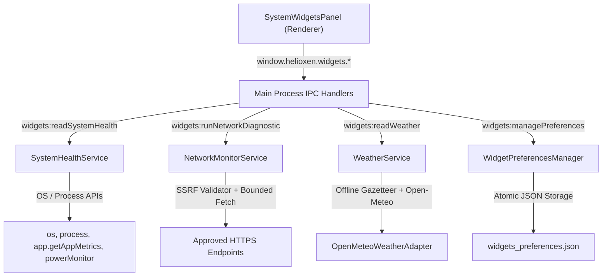

# HELIOXEN System Health, Network Monitoring, and Weather Widgets Architecture

**Project:** HELIOXEN  
**Roadmap:** Phase 13, Visual Intelligence and Information Interfaces  
**Step:** 39 of 48  
**Module:** `src/shared/widgets/*`, `src/main/widgets/*`, `src/renderer/src/components/widgets/*`

---

## 1. Objectives and Scope Exclusions

Step 39 implements three lightweight, dependable information widgets inside HELIOXEN:
1. **System Health:** Observability of local machine resources (CPU, host memory, storage capacity, power/battery state) and HELIOXEN application process metrics (heap, RSS, process CPU, process health evaluation).
2. **Network Monitor:** Local connectivity indication and bounded, user-controlled HTTPS diagnostic requests against an approved endpoint allowlist measuring request round-trip time.
3. **Weather Intelligence:** Current atmospheric conditions, 24-hour hourly forecast, and 7-day daily forecast for user-selected locations powered by Open-Meteo with offline gazetteer disambiguation.

### Explicit Exclusions
- No autonomous agents or plugin connectors (Step 40+).
- No LAN discovery, port scanning, packet capture, or promiscuous sniffing.
- No network configuration changes, firewall alterations, or proxy/VPN manipulation.
- No arbitrary shell commands (`powershell`, `cmd`, `bash`).
- No continuous high-frequency background polling loops or persistent OS daemons.
- No silent or automatic device geolocation.
- No fabricated hardware sensor values (GPU temperatures or fan speeds requiring privileged kernel drivers are reported as unsupported).

---

## 2. Pre-Implementation Audit Findings

- **Step 28 Telemetry Integration:** Reused and extended `SystemTelemetryManager` concepts (`os.totalmem`, `os.freemem`, `fs.promises.statfs`, CPU tick sampling) while strictly distinguishing host OS metrics from HELIOXEN process metrics (`process.memoryUsage()`, `app.getAppMetrics()`).
- **Electron APIs:** Leveraged Electron 33.2 APIs: `powerMonitor.isOnBatteryPower()`, `net.isOnline()`, and `app.getAppMetrics()`.
- **Weather & Geocoding:** Evaluated Open-Meteo API (`api.open-meteo.com`) under CC BY 4.0 terms. Combined Open-Meteo geocoding search with Step 38's built-in gazetteer (`WORLD_MONITOR_GAZETTEER`) for instant offline candidate resolution and homonym disambiguation.

---

## 3. Widget & Service Architecture

Each widget has an independent lifecycle:
- System Health operates locally without internet access.
- Network Monitor tests local link status without depending on weather.
- Weather displays fresh, cached, or honest offline fallback data independently.
- Failure of one service never breaks the rendering or refresh cycle of another.

---

## 4. Supported Operating Systems & Metrics Semantics

- **Target Platforms:** Windows 10/11, macOS, Linux (running on Electron 33.2 / Node 20.17).
- **Available Metrics & Semantics:**
  - `host.totalMemoryBytes` / `freeMemoryBytes` / `usedMemoryBytes`: Instantaneous host physical RAM from `os.totalmem()` and `os.freemem()`.
  - `host.cpuUtilizationPercent`: Delta ratio of active ticks vs. total ticks across all logical CPU cores over a bounded sample interval (50–500ms).
  - `host.systemUptimeSeconds`: System-wide uptime from `os.uptime()`.
  - `storage.totalBytes` / `availableBytes` / `usedBytes`: Primary volume capacity from `fs.promises.statfs`.
  - `helioxenProcess.memoryRssBytes` / `heapUsedBytes`: Process-specific RAM consumption from `process.memoryUsage()`.
  - `helioxenProcess.cpuUtilizationPercent`: Process-specific CPU time from `app.getAppMetrics()` or `process.cpuUsage()`.
  - `powerAndSensors.powerSource`: `'battery'` vs `'ac_power'` derived from `powerMonitor.isOnBatteryPower()`.

---

## 5. Distinction Between System Metrics and Application Metrics

To prevent misleading claims:
- System CPU load measures whole-system utilization across all running software.
- HELIOXEN CPU load measures only HELIOXEN's main and helper processes.
- Process Health status (`nominal`, `elevated`, `high`) evaluates whether HELIOXEN's heap or CPU exceed defined operational thresholds (>512MB / >40% CPU -> elevated; >1GB / >75% CPU -> high), clearly labeled as an application advisory check.

---

## 6. Honest Hardware Sensor Handling (Zero Fabrication)

- **Thermal State:** Supported only on platforms where the OS exposes it through documented Electron APIs (`powerMonitor.getCurrentThermalState` on macOS). On Windows and Linux, `thermalState` is marked `unsupported` with a clear explanation.
- **GPU Temperature & Fan Speed:** Documented as `status: 'unsupported'` and `value: null`. HELIOXEN never introduces unapproved native kernel drivers or fabricates synthetic sensor temperatures.

---

## 7. Network Connectivity & Bounded Diagnostic Semantics

- **Local Connectivity:** `net.isOnline()` reports local network adapter link status.
- **Diagnostic Operations:**
  - Bounded HTTPS requests only (`validateDiagnosticTargetUrl`).
  - Pre-approved allowlist: Cloudflare Trace, Cloudflare 1.1.1.1, Google 204, Httpbin.
  - Strict SSRF defense: blocks `127.0.0.1`, `localhost`, `10.*`, `192.168.*`, `169.254.169.254`, `::1`.
  - Request round-trip time is labeled strictly as single-endpoint round-trip time.
  - Mandatory disclaimer attached to every result stating that it does not measure ICMP ping, ISP packet loss, or global internet reachability.
  - In-flight tests can be cancelled immediately via `cancelNetworkDiagnostic()`.

---

## 8. Weather Provider, Location Privacy & Data Normalization

- **Provider:** Open-Meteo (`api.open-meteo.com`) under CC BY 4.0 terms.
- **Licensing Compliance:** Attribution is prominently displayed in the widget footer. Supports optional commercial API keys (`customer-api.open-meteo.com`) for commercial deployments.
- **Location Selection & Privacy:**
  - Location is exclusively user-selected through city search or coordinate entry.
  - Zero silent device geolocation.
  - Search queries leverage Step 38 gazetteer first for instant offline candidate disambiguation (e.g., Paris, France vs. Paris, Texas), supplemented by Open-Meteo geocoding.
- **Data Normalization:**
  - WMO weather codes (0–99) are mapped to honest descriptions and icons without guessing.
  - Temperature unit preferences: Celsius (°C) and Fahrenheit (°F).
  - Wind speed unit preferences: km/h and mph.
  - Timezone: respects provider `timezone: 'auto'` / forecast-local time.
- **Cache & Freshness Policy:**
  - Forecasts are cached in memory for 30 minutes.
  - Network failure with an existing cache returns `freshnessStatus: 'stale'`.
  - Network failure with no cache returns `freshnessStatus: 'offline_fallback'` without synthetic temperatures.

---

## 9. Performance & Resource Management

- No high-frequency polling loops: default UI refresh interval is 10s for System Health and 15m for Weather.
- Snapshot caching: System Health caches samples for 1.5s to prevent CPU churn on rapid UI queries.
- Clean timer and listener cleanup on component unmount and window unload.
- Automatic cancellation of stale network diagnostic requests before launching new tests.

