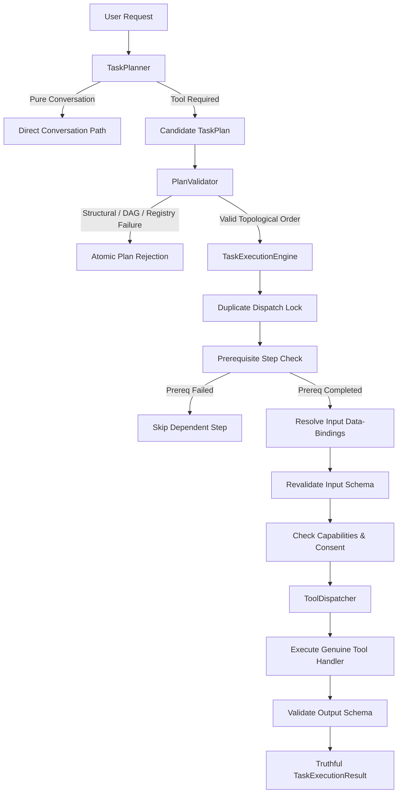

# HELIOXEN AI — Task Planner, Execution Engine and Multi-Step Agent Orchestration
**Architecture Reference & Security Specification · Roadmap Step 26 of 48**

---

## 1. Executive Summary & Core Principle

In Phase 9 (Step 26), HELIOXEN implements an authoritative, security-first task-planning and multi-step execution orchestration framework.

### Primary Engineering Principle
> **The AI model may propose what should happen. HELIOXEN's trusted application logic must decide whether the proposed plan is valid, whether its operations are permitted under current capability policies, and whether execution may proceed.**

No model-generated plan, tool identifier, candidate argument, or permission assertion is trusted. All operations are resolved exclusively against the authoritative Step 25 `ToolRegistry`, verified by the Security Authorizer, checked for required human confirmations, executed through genuine trusted bindings, and validated against registered schemas both immediately before dispatch and after execution.

---

## 2. Architectural Components



### 2.1 Subsystem Breakdown

1. **`TaskPlanner` (`src/shared/orchestration/TaskPlanner.ts`)**:
   - Classifies incoming requests.
   - Preserves the direct conversational path for non-tool queries (`requiresTools: false`, empty steps).
   - Synthesizes candidate plans for multi-step tool queries.
   - Detects missing parameters and requests clarification rather than hallucinating paths.
   - Detects prohibited tool requests (e.g. `run command`, `powershell`) and refuses them immediately.

2. **`PlanValidator` (`src/shared/orchestration/PlanValidator.ts`)**:
   - Enforces Zod schema compliance (`TaskPlanSchema`).
   - Validates size limits (`<= 256 KB`), step count bounds (`<= 10`), and max dependency depth (`<= 5`).
   - Checks tool existence and active availability in Step 25 `ToolRegistry`.
   - Runs topological sorting via Kahn's algorithm; rejects self-dependencies, dangling references, and cycles atomically before any execution begins.
   - Ensures data-binding tokens (`"$step.<dep>.output.<path>"`) reference only declared prerequisite dependencies.

3. **`ToolDispatcher` (`src/shared/orchestration/ToolDispatcher.ts`)**:
   - Maps registered tool IDs (`system:get_time`, `workspace:get_context_summary`, `documents:extract_text`, `media:get_capture_sources`, `models:list_available`) to genuine internal handlers.
   - Strictly bars prohibited tools (`shell:execute`).
   - Forbids dynamic evaluation (`eval`, `new Function`, `child_process.exec`).

4. **`TaskExecutionEngine` (`src/shared/orchestration/TaskExecutionEngine.ts`)**:
   - Enforces a single-execution lock per task ID to prevent duplicate dispatch.
   - Executes steps sequentially according to the validated topological order.
   - Resolves `$step.<id>.output.<path>` bindings from completed prerequisite outputs.
   - Re-validates resolved inputs against the tool's `inputSchema` immediately prior to dispatch.
   - Re-evaluates capabilities with the Security `Authorizer` and enforces Human Confirmation gates.
   - Enforces per-step timeouts.
   - Validates returned outputs against the tool's `outputSchema` before storing or passing downstream.
   - Halts on step failure (fail-fast), marks dependent steps as skipped, and reports truthful partial or complete outcomes.

---

## 3. Task Lifecycle State Machine

Tasks progress through explicit, legal state transitions centralized in application logic:

- `created`: Initial task record initialized.
- `planning`: Analyzing user prompt and evaluating candidate tool operations.
- `awaiting_clarification`: User prompt lacks necessary parameters (e.g. document file path).
- `plan_ready`: Plan generated and prepared for validation.
- `validating`: PlanValidator performing structural, DAG, registry, and binding checks.
- `validation_failed`: Plan rejected atomically due to schema error, cycle, or unknown/prohibited tool.
- `awaiting_approval`: Step requires explicit human confirmation before execution.
- `ready_for_execution`: Plan approved and queued for dispatch.
- `executing`: Active sequential dispatch of plan steps.
- `completed`: All declared steps finished successfully.
- `failed`: A required step or prerequisite failed; execution terminated safely.
- `rejected`: Security or policy gate rejected execution.

---

## 4. Execution Limits and Bounds

| Boundary Constraint | Limit | Rationale |
| :--- | :--- | :--- |
| **Max Steps per Plan** | 10 steps | Prevents runaway planning and bounded execution complexity. |
| **Max Dependency Depth** | 5 levels | Limits dependency graph nesting and stack depth. |
| **Max Dependencies per Step** | 5 prerequisites | Bounds fan-in complexity for multi-step dependencies. |
| **Max Plan Payload Size** | 256 KB | Prevents memory exhaustion and oversized prompt payloads. |
| **Default Step Timeout** | 30,000 ms (30s) | Prevents hung operations or infinite loops. |
| **Max Task Timeout** | 120,000 ms (2m) | Enforces total duration bound on orchestration. |
| **Nested Orchestration** | Disabled | Autonomous recursive task spawning is barred. |

---

## 5. Multi-Step Data-Binding Example

Below is a concrete, validated example demonstrating how Step 1 (`system:get_time`) extracts the operating system's timezone, and Step 2 (`utility:echo_timezone`) consumes that timezone via reference binding:

```json
{
  "id": "plan_demo_101",
  "taskId": "task_demo_101",
  "conversationId": "conv_demo_main",
  "version": "1.0.0",
  "intent": "Retrieve local timezone and pass to downstream tool",
  "requiresTools": true,
  "steps": [
    {
      "id": "step_get_time",
      "toolId": "system:get_time",
      "description": "Retrieve current local time and timezone metadata",
      "input": {
        "timezone": "America/New_York"
      },
      "dependencies": []
    },
    {
      "id": "step_consume_tz",
      "toolId": "utility:echo_timezone",
      "description": "Receive and verify timezone emitted by step_get_time",
      "input": {
        "receivedTz": "$step.step_get_time.output.timezone"
      },
      "dependencies": ["step_get_time"]
    }
  ],
  "createdAt": 1793450000000
}
```

### Execution Flow:
1. `PlanValidator` verifies that `step_consume_tz` declares `step_get_time` as a dependency and that no cycle exists.
2. `TaskExecutionEngine` executes `step_get_time` -> output: `{ timezone: "America/New_York", ... }`.
3. Before dispatching `step_consume_tz`, `substituteDataBindings` replaces `"$step.step_get_time.output.timezone"` with `"America/New_York"`.
4. The resolved input `{ receivedTz: "America/New_York" }` is validated against `utility:echo_timezone`'s `inputSchema`.
5. The tool executes and returns `{ verified: true, tz: "America/New_York" }`, which is validated against `outputSchema`.
6. Final task result is assembled with status `'completed'`.

---

## 6. Security & Policy Enforcement

1. **Untrusted Model Outputs**: All model responses are treated as raw, untrusted data. Tool names cannot resolve to arbitrary internal functions.
2. **Prohibited Tools**: Permanently banned capabilities (such as `shell:execute`, `shell:executeCommand`, and `os:runScript`) are rejected at both validation time and pre-dispatch time.
3. **Least Privilege**: Capabilities are checked per step using the `Authorizer`.
4. **Human Confirmation**: Tools with `confirmationPolicy: 'user_confirmation'` or steps marked `requiresConfirmation: true` cannot run without matching explicit user approval tokens.
5. **Context Isolation**: Tasks and plan steps are scoped to their owning `conversationId`. Cross-conversation result reuse is strictly prohibited.

---

## 7. Deferred to Step 27

In strict compliance with roadmap boundaries, the following capabilities are **explicitly deferred to Step 27**:
- Dedicated live progress streaming UI dashboard.
- Comprehensive cancellation coordinator and abort event bus.
- Automatic retries, backoff policies, and recovery orchestration.
- Long-term execution audit trail persistence.
