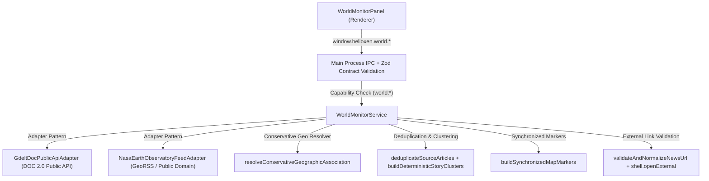

# HELIOXEN World Monitor: Interactive Globe, Geographic Maps & News Intelligence Architecture

**Project:** HELIOXEN  
**Roadmap:** Phase 13, Visual Intelligence and Information Interfaces  
**Step:** 38 of 48  
**Module:** `src/shared/world/*`, `src/main/world/*`, `src/renderer/src/components/world/*`

---

## 1. Architectural Overview

World Monitor provides a situational-awareness, geospatial navigation, and source-attributed news intelligence workspace inside HELIOXEN. It strictly separates untrusted external news metadata and map reference layers from privileged Electron APIs, enforces conservative geographic association rules, and guarantees factual integrity across all displayed timestamps, source URLs, and story clusters.

---

## 2. Interactive 3D Globe & 2D Flat Map Architecture

- **3D Interactive Globe (`three` `^0.187.0`):**
  - Renders a WebGL 3D sphere with latitude/longitude graticules, Natural Earth 1:110m simplified continent outlines (`NATURAL_EARTH_SIMPLIFIED_POLYGONS`), and interactive camera orbit, pan, and zoom (`0.6x` to `3.6x`).
  - Converts WGS84 `(latitude, longitude)` coordinates to 3D unit-sphere coordinates and projects visible front-hemisphere markers onto an accessible interactive overlay.
  - Handles `webglcontextlost` and headless/non-WebGL environments gracefully by automatically switching to the 2D flat map view (`webglFallbackActive = true`).
- **2D Equirectangular Vector Map:**
  - Provides a crisp SVG equirectangular projection (`[-180, 180]` longitude, `[-90, 90]` latitude) with Natural Earth 1:110m reference polygons, graticule lines, zoom/pan support, and synchronized marker clusters.

---

## 3. Map Provider Compliance, Licensing & Attribution

- **Default Map Provider (`DEFAULT_MAP_PROVIDER_CONFIG`):**
  - Provider ID: `natural-earth-110m-vector`
  - License: Public Domain (Natural Earth 1:110m reference outlines + WGS84 graticule)
  - Attribution: `"Basemap geometry derived from Natural Earth (Public Domain, 1:110m). News metadata attributed to respective publishers."`
  - **Tile Scraping Prevention:** `requiresTileServer: false`, `requiresApiKey: false`. HELIOXEN never performs unauthenticated bulk tile scraping against community OpenStreetMap tile servers (`tile.openstreetmap.org`).

---

## 4. Gazetteer Search, Disambiguation & Coordinate Validation

- **Coordinate Validation (`validateGeographicCoordinates`):**
  - Enforces finite numeric `latitude` in `[-90, 90]` and `longitude` in `[-180, 180]`.
  - Rejects `NaN`, `Infinity`, `null`, `undefined`, string coercion, and swapped coordinates (e.g., latitude `139.69` / longitude `35.68`).
- **Curated Gazetteer & Homonym Disambiguation (`WORLD_MONITOR_GAZETTEER`, `searchGazetteerLocations`):**
  - Supports deterministic search across sovereign states, capitals, major cities, and geographic landmarks.
  - Preserves distinct candidate entries with explicit `disambiguationLabel` values for ambiguous place names (e.g., `Paris, Île-de-France, France` vs. `Paris, Texas, United States`; `London, England, United Kingdom` vs. `London, Ontario, Canada`; `Cairo, Egypt` vs. `Cairo, Illinois, United States`).
  - Supports direct `lat, lon` coordinate queries (e.g., `35.6762, 139.6503`).

---

## 5. News Intelligence Adapter Architecture & Terms-of-Use Compliance

- **Provider-Neutral Adapter Interface (`WorldNewsSourceAdapter`):**
  - Each adapter declares a `WorldNewsSourcePolicy` specifying `sourceId`, `displayName`, `sourceType`, `termsSummary`, `attributionText`, `maxRetentionHours`, `minRefreshIntervalMs`, `rateLimitPerHour`, and `allowsFullTextCaching: false`.
- **Built-In Compliant Adapters:**
  1. **`GdeltDocPublicApiAdapter` (`gdelt-doc-api`):** Queries the GDELT Project DOC 2.0 Public API (`api.gdeltproject.org`) for headline metadata, publisher attribution, and source links (`maxRetentionHours: 24`, `minRefreshIntervalMs: 300_000`).
  2. **`NasaEarthObservatoryFeedAdapter` (`nasa-earth-observatory`):** Parses the public-domain NASA Earth Observatory RSS/GeoRSS feed (`earthobservatory.nasa.gov/feeds/earth-observatory.rss`) with explicit `georss:point` coordinates (`maxRetentionHours: 72`, `minRefreshIntervalMs: 600_000`).
- **Seed Baseline Snapshot:**
  - Provides clearly attributed baseline items so World Monitor remains functional offline or during strict air-gapped sessions, while explicitly reporting freshness status (`fresh`, `cached`, `stale_partial_failure`, `rate_limited`, `offline_fallback`).

---

## 6. Factual Integrity, Timestamp Honesty & Conservative Geographic Association

- **Timestamp Honesty (`parseConservativeSourceTimestamp`):**
  - Preserves `publishedAt` separately from `retrievedAt`.
  - If a source omits or provides an invalid publication timestamp, `publishedAt` is stored as `null` (`publishedAtStatus: 'missing_from_source'`) and the UI displays `"Publication time not provided by source"` rather than substituting `retrievedAt`.
- **Conservative Geographic Association (`resolveConservativeGeographicAssociation`):**
  - Classifies every article into one of five explicit association types:
    1. `event_location` (`exact_coordinates` or `city_or_region`): Plotted as a primary event marker.
    2. `mentioned_location` (`city_or_region`): Plotted as a secondary mentioned-place marker.
    3. `country_level` (`country_centroid`): Plotted at the country centroid with an explicit `"Country-level"` badge so users never mistake a national centroid for exact incident coordinates.
    4. `publication_origin`: Never plotted as an event location (`plottableOnMap: false`).
    5. `unresolved`: Kept in the news feed with badge `"Unmapped / Global"` and excluded from map markers (`plottableOnMap: false`).

---

## 7. Deduplication, Story Clustering & Cache Retention Policy

- **Same-Source Deduplication (`deduplicateSourceArticles`):**
  - Collapses repeated identical items from the same source (`sourceId + normalized canonical URL` or `sourceId + normalized title + date bucket`).
- **Multi-Source Story Clustering (`buildDeterministicStoryClusters`):**
  - Groups related coverage across distinct publishers while preserving every individual publisher's headline, timestamp, and URL.
  - Attaches an explicit `verificationDisclaimer` stating that shared coverage across publishers is not a guarantee of independent factual verification.
- **Per-Source Cache Retention (`pruneExpiredCachedArticles`):**
  - Automatically prunes cached items older than their adapter's `maxRetentionHours` (`24h` for GDELT metadata, `72h` for NASA Earth Observatory).

---

## 8. Security, SSRF Protection, External URL Policy & Resource Lifecycle

- **Strict URL Sanitization (`validateAndNormalizeNewsUrl`):**
  - Permits only `https:` and `http:` schemes.
  - Rejects `javascript:`, `data:`, `file:`, `vbscript:`, `blob:`, `about:`, embedded credentials, and private/loopback/link-local hosts (`localhost`, `127.0.0.1`, `10.*`, `172.16-31.*`, `192.168.*`, `169.254.169.254`, `::1`).
  - Strips tracking query parameters (`utm_*`, `fbclid`, `gclid`).
- **Safe External Link Opening (`worldMonitorService.openExternalSourceUrl`):**
  - Re-validates the URL in the main process before invoking `shell.openExternal(validation.normalizedUrl)`.
- **Clean Resource Lifecycle:**
  - Cancels in-flight `AbortController` requests and disposes the Three.js `WebGLRenderer`, geometries, materials, and `ResizeObserver` when switching away from World Monitor or quitting HELIOXEN.

