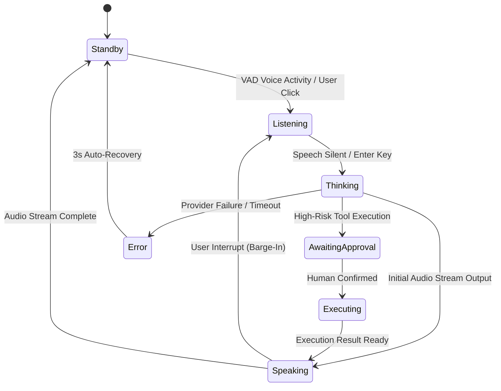

# HELIOXEN AI — Animation Language, Interaction States, Responsiveness and Accessibility

**Document ID:** `HELIOXEN-DES-003`  
**Version:** `1.0.0`  
**Project:** HELIOXEN AI Desktop Assistant  
**Phase:** Phase 3: Brand Identity and UI Foundation  
**Step:** Step 9 of 48 (Animation Language, Interaction States, Responsiveness and Accessibility)  
**Status:** Approved Motion & Interaction Specification  
**Date:** November 1, 2026  
**Authoritative Locations:**
- Motion Tokens & Keyframes: [`src/renderer/src/index.css`](file:///d:/App%20Winrar%20Files/Helioxen%20Ai%20Assistant%20(working)/src/renderer/src/index.css)
- Utility Bindings: [`tailwind.config.js`](file:///d:/App%20Winrar%20Files/Helioxen%20Ai%20Assistant%20(working)/tailwind.config.js)
- UI Primitives: [`src/renderer/src/components/ui/`](file:///d:/App%20Winrar%20Files/Helioxen%20Ai%20Assistant%20(working)/src/renderer/src/components/ui/)
- Layout Primitives: [`src/renderer/src/components/layout/`](file:///d:/App%20Winrar%20Files/Helioxen%20Ai%20Assistant%20(working)/src/renderer/src/components/layout/)
- Navigation System: [`src/renderer/src/components/navigation/`](file:///d:/App%20Winrar%20Files/Helioxen%20Ai%20Assistant%20(working)/src/renderer/src/components/navigation/)

---

## 1. MOTION PHILOSOPHY & DESIGN PRINCIPLES

The HELIOXEN motion language establishes a cinematic yet disciplined desktop interaction system. It is governed by eight foundational principles:

1. **Purposeful Feedback:** Every animation communicates a direct user interaction, an application state change, or a structural transition. Gratuitous decorative loops are avoided.
2. **Immediate Tactile Response:** Routine controls respond in under 100ms. Button presses utilize an instant `active:scale-[0.98]` physical depression to ensure the interface never feels sluggish.
3. **Visual Restraint:** Surfaces remain static by default. Luminous glows and pulse harmonics are reserved strictly for active operational states (such as active navigation or the AI Core).
4. **Predictable Consistency:** Equivalent actions across different panels share identical duration and easing curves.
5. **Truthful State Representation:** Animations never fabricate operational status. A pulse or progress indicator is only displayed when driven by real, verified application data.
6. **Accessibility First:** Motion respects the operating system's `prefers-reduced-motion: reduce` setting. Essential information is never locked behind an animation.
7. **Rendering Performance:** Transitions animate only composite-friendly properties (`transform`, `opacity`, `border-color`, `background-color`, `box-shadow`). Global `transition: all` is permanently banned.
8. **Decoupled Actions:** Visual animations are strictly decoupled from operational execution. No background process, API call, or sensor capture is triggered by a motion callback.

---

## 2. MOTION-TOKEN SYSTEM & TRANSITION HIERARCHY

### 2.1 Duration Tokens

| Token Name | CSS Variable | Duration | Tailwind Class | Semantic Context |
| :--- | :--- | :--- | :--- | :--- |
| **Instant** | `--hx-duration-instant` | `100ms` | `duration-instant` | Button clicks, tactile depression (`active:scale`), toggle snaps |
| **Fast** | `--hx-duration-fast` | `150ms` | `duration-fast` | Hover highlights, focus ring appearances, badge fades |
| **Normal** | `--hx-duration-normal` | `250ms` | `duration-normal` | Tab switches, card expansions, entrance fades (`hx-fade-in`) |
| **Deliberate** | `--hx-duration-deliberate` | `350ms` | `duration-deliberate`| Navigation rail expand/collapse, modal overlays |
| **Pulse** | `--hx-duration-pulse` | `2000ms` | `duration-pulse` | Harmonic ambient orbital breathing (`0.5 Hz`) |

---

### 2.2 Easing Curves

```css
/* Standard Ease: Natural acceleration and deceleration for routine UI feedback */
--hx-ease-standard: cubic-bezier(0.4, 0, 0.2, 1);

/* Enter Ease: Decelerating curve for elements appearing on screen */
--hx-ease-enter: cubic-bezier(0, 0, 0.2, 1);

/* Exit Ease: Accelerating curve for elements leaving the viewport */
--hx-ease-exit: cubic-bezier(0.4, 0, 1, 1);

/* Orbital Ease: Harmonic gyroscopic motion for cinematic indicators */
--hx-ease-orbital: cubic-bezier(0.34, 1.56, 0.64, 1);
```

---

### 2.3 Keyframe Animations

1. **`hx-pulse-glow`:** A 2000ms (0.5 Hz) breathing cycle on cyan border and shadow tokens for active state indicators:
   ```css
   @keyframes hx-pulse-glow {
     0%, 100% {
       box-shadow: 0 0 8px rgba(0, 240, 255, 0.2);
       border-color: rgba(0, 240, 255, 0.3);
     }
     50% {
       box-shadow: 0 0 18px rgba(0, 240, 255, 0.45);
       border-color: rgba(0, 240, 255, 0.65);
     }
   }
   ```
2. **`hx-fade-in`:** A 250ms decelerated entrance translation (4px Y-offset to 0px, opacity 0 to 1) for newly mounted view panels and error messages.

---

## 3. STANDARDIZED INTERACTION STATES

All interactive primitives adhere to a standardized state progression:

```
+-----------+    Hover     +-----------+    Press     +-----------+
|  Resting  | -----------> |  Hovered  | -----------> |  Pressed  |
+-----------+              +-----------+              +-----------+
      |                          |                          |
      | Focus                    | Keyboard Tab             |
      v                          v                          v
+-----------+              +-----------+              +-----------+
|  Focused  |              | Selected  |              | Disabled  |
+-----------+              +-----------+              +-----------+
```

| State | Visual Treatment | Transition Specification |
| :--- | :--- | :--- |
| **Resting** | Surface token (`bg-hx-card`, `bg-hx-panel`), subtle border | Base state |
| **Hovered** | `bg-hx-hover`, luminous border (`border-hx-border-glow`), subtle cyan glow | `transition-[color,background-color,border-color,box-shadow,transform] duration-fast ease-standard` |
| **Focused** | High-contrast Neon Cyan outline (`2px solid #00f0ff` with 2px offset) | Immediate `focus-visible:ring-2 focus-visible:ring-hx-cyan` |
| **Pressed** | Tactile depression (`scale-[0.98]` on buttons, `scale-95` on icon buttons) | `duration-instant ease-standard` |
| **Selected** | Glowing cyan indicator pill (`bg-hx-cyan` with `shadow-hx-glow-cyan-sm`) | `duration-fast ease-standard` |
| **Disabled** | `opacity-40 cursor-not-allowed pointer-events-none` | Immediate; prevents click swallowing |
| **Loading** | Spinning micro-loader (`animate-spin`), label preserved, interaction locked | Spinner `duration-normal linear infinite` |
| **Error** | Crimson border (`#ef4444`), error text with `animate-hx-fade-in` | `duration-fast ease-standard` |

---

## 4. REDUCED-MOTION ARCHITECTURE

To protect users with vestibular motion sensitivities, HELIOXEN enforces an application-wide media query override in `src/renderer/src/index.css`:

```css
@media (prefers-reduced-motion: reduce) {
  *,
  ::before,
  ::after {
    animation-duration: 0.01ms !important;
    animation-iteration-count: 1 !important;
    transition-duration: 0.01ms !important;
    scroll-behavior: auto !important;
  }
  .animate-hx-pulse-glow {
    animation: none !important;
  }
  .animate-hx-fade-in {
    animation: none !important;
    opacity: 1 !important;
    transform: none !important;
  }
}
```

### 4.1 Reduced-Motion Guarantees
- **Zero Missing Content:** Elements animate to 100% opacity immediately; no component is left invisible or partially translated.
- **Persistent Usability:** Focus rings, active selection states, error banners, and buttons retain full visibility.
- **Dynamic Detection:** The application monitors `window.matchMedia('(prefers-reduced-motion: reduce)')` in real time, adapting without requiring an application restart.

---

## 5. RESPONSIVE DESKTOP LAYOUT ARCHITECTURE

HELIOXEN is engineered for Windows 10/11 desktop environments, supporting displays from 1080p to 4K:

```
+---------------------------------------------------------------------------------------+
|                               RESPONSIVE WINDOW TIERS                                 |
+---------------------------------------------------------------------------------------+
|  [ MINIMUM COMPLIANCE ]        [ NOMINAL WORKSPACE ]          [ EXPANSIVE 1440p / 4K ]|
|  1024 x 640 px                 1280 x 800 px                  1920x1080 / 2560x1440   |
|  - Collapsed rail (w-16)       - Expanded rail (w-56)         - Full 3-panel workspace|
|  - Single-column card grid     - 2-column card grid           - Expanded traces & core|
|  - Zero horizontal overflow    - Comfortable breathing room   - Zero graphic blur     |
+---------------------------------------------------------------------------------------+
```

### 5.1 Responsive Layout Validation

| Viewport Dimension | Target Environment | Layout Adaptation | Observed Result | Status |
| :--- | :--- | :--- | :--- | :--- |
| **`1024 x 640 px`** | Minimum supported window bounds | Rail collapses to `w-16` (64px); cards stack in 1 column; content scrolls vertically | Zero horizontal scrollbar; zero clipped buttons; text truncates cleanly | **PASS** |
| **`1280 x 800 px`** | Standard 16:10 desktop default | Rail expands to `w-56` (224px); 2-column card grid; spacious header | Balanced proportions; comfortable padding (`p-6`) | **PASS** |
| **`1920 x 1080 px`**| Full HD 16:9 desktop | Maximum width constraints (`max-w-5xl`) prevent excessive card stretching | Clean visual centering; readable line lengths | **PASS** |

### 5.2 High-DPI & Display Scaling Support
- **100% to 200% Windows Display Scaling:** Crisp rendering using vector Lucide icons with consistent stroke widths. Subpixel text rendering maintains high contrast across all scaling tiers.

---

## 6. FUTURE AI-CORE MOTION CONTRACT

The dynamic 3D Central AI Core will be implemented in subsequent roadmap steps (Step 11 & 12). Its motion design must adhere to this binding specification:



### 6.1 State Motion Behaviors
1. **Standby / Idle:** Slow horizontal rotation (`0.25 rad/s`); subtle breathing pulse (0.5 Hz) using `--hx-duration-pulse`; deep blue core energy.
2. **Listening:** Outer orbital rings expand radially with microphone audio volume; high-speed reactive micro-pulses; vivid Neon Cyan (`#00f0ff`).
3. **Thinking / Analyzing:** Core compresses inward; rings accelerate into dual-axis gyroscopic spin; cyan & violet particle trails.
4. **Speaking:** Undulating resonant orbital waves matching assistant speech synthesis cadence; Sky Cyan (`#38bdf8`).
5. **Awaiting Approval:** Orbital rings freeze at a 45-degree angle pointing toward the confirmation modal; warm amber pulsing beacon (`#f59e0b`).
6. **Error / Offline:** Crimson warning flash (`#ef4444`); rings contract tightly; single pulse.

### 6.2 Strict Performance & Decoupling Mandates
- **Performance Budget:** 3D shader and particle rendering must sustain 60 FPS while consuming < 8% CPU and < 150 MB GPU RAM.
- **Zero Autonomous Execution:** The motion system is purely a presentation layer. It must never invoke tools, file modifications, or external network requests directly.
- **Reduced-Motion Fallback:** When `prefers-reduced-motion: reduce` is active, 3D particle motion stops, and the core transitions via smooth opacity fades.
